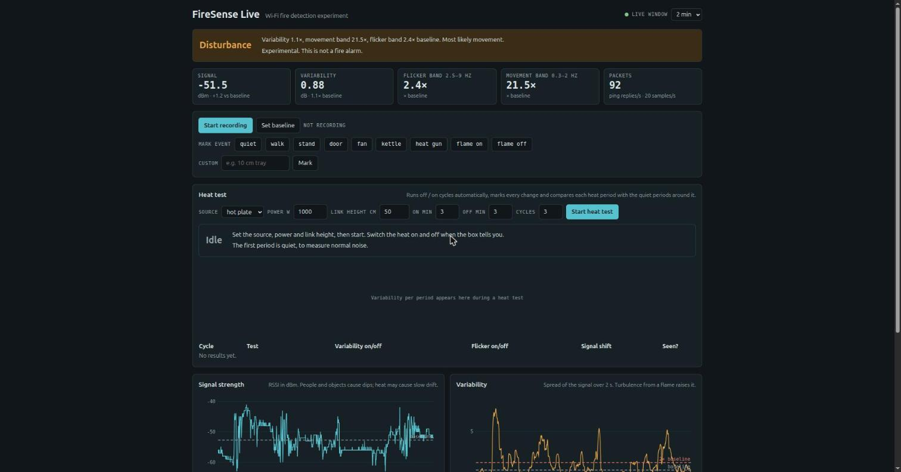

# FireSense

Wi-Fi fire detection experiments on a Raspberry Pi 5, built with Nerves.
The Pi joins your router over Wi-Fi, pings it 100 times a second so the radio
always has traffic, and samples the signal 20 times a second (every 50 ms).

## Build and burn

```bash
export MIX_TARGET=rpi5
export WIFI_SSID="YourRouterName" WIFI_PSK="your-password" WIFI_COUNTRY="KE"
mix deps.get
mix firmware
mix burn            # with the Pi 5's microSD card in your computer
```

Later updates over the network: `mix upload nerves.local`.

## Live dashboard



Open http://nerves.local in a browser on the same network: live graphs of signal,
variability, flicker spectrum and link health, buttons to record and mark events,
and a baseline comparison that flags fire-like flicker.

Preview it on a laptop with fake data: `iex -S mix`, then http://localhost:4000.

## Record a session

```bash
ssh nerves.local
```

```elixir
FireSense.start()          # begins recording to /data/sessions/<timestamp>
FireSense.mark("quiet")    # note each event as it happens
FireSense.mark("walk")
FireSense.status()         # latest reading, row count
FireSense.stop()
```

Check the Wi-Fi link first: `VintageNet.info()` should show wlan0 connected.

## Plot

```bash
scp -r nerves.local:/data/sessions .
python3 tools/plot_session.py sessions/<timestamp>
```

## Data files

Each recording session is a folder `/data/sessions/<timestamp>/`.

**`wifi.csv`**: one row every 50 ms

| Column | Unit | Example | Meaning |
|---|---|---|---|
| `time` | Unix seconds | `1794070467.811` | When the sample was taken |
| `signal_dbm` | dBm | `-48` | Received signal strength (RSSI) from the router |
| `linkspeed_mbps` | Mbit/s | `72` | Current Wi-Fi data rate |
| `frequency_mhz` | MHz | `2437` | Channel frequency (2.4 GHz band) |
| `width` | text | `20 MHz` | Channel width |
| `ping_replies` | count | `4` | Echo replies from the router since the last sample |

**`events.csv`**: one row per mark

| Column | Unit | Example | Meaning |
|---|---|---|---|
| `time` | Unix seconds | `1794070500.120` | When the button was pressed |
| `note` | text | `heat on` | Event label (quiet, walk, heat on, heat off, …) |

## Dashboard readings

| Tile | What it measures | Fire would show |
|---|---|---|
| Signal | Mean RSSI vs baseline | Small slow drift |
| Variability | Signal spread over 2 s | Rises with plume turbulence |
| Flicker band 2.5–9 Hz | Spectral power vs baseline | Rises (flame flicker) |
| Movement band 0.3–2 Hz | Spectral power vs baseline | Stays near 1× |
| Packets | Ping replies/s, samples/s | Stays steady (link health) |

Verdict rule: **Fire-like flicker** when flicker ≥ 3×, variability ≥ 1.5× and
flicker power exceeds movement power; otherwise **Disturbance** or **Quiet**.

## Results

### Baseline link (Pi 5 ↔ Huawei router, 2.4 GHz)

| Date | Signal | Variability | Flicker | Movement | Packets | Verdict | Notes |
|---|---|---|---|---|---|---|---|
| 2026-11-07 | −51.5 dBm (+1.2) | 0.88 dB (1.1×) | 2.4× | 21.5× | 92/s, 20 samples/s | Disturbance | People moving in the room; no heat source |

### Heat tests

A cycle counts as **seen** if variability on/off ≥ 1.3×, flicker on/off ≥ 2×,
or the signal shifts by ≥ 1 dB.

| Date | Source | Power (W) | Link height (cm) | On/off (min) | Cycles | Variability on/off | Flicker on/off | Signal shift | Seen |
|---|---|---|---|---|---|---|---|---|---|
| _pending_ | hot plate | 1000 | 50 | 3/3 | 3 | – | – | – | – |
